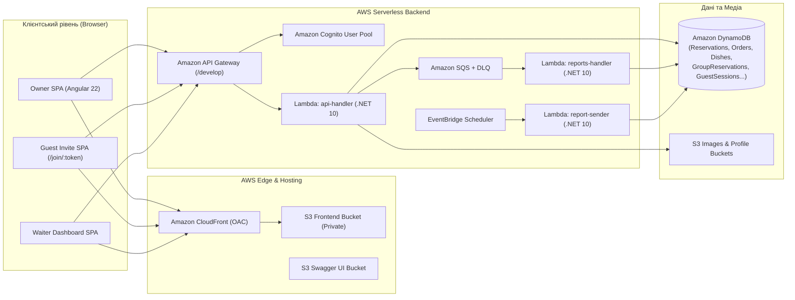

# Green & Tasty — Restaurant Management & Group Pre-Order Platform (EPAM IT Marathon 2026)

Повнофункціональна хмарна платформа для бронювання столиків у мережі ресторанів **«Green & Tasty»**, спільного групового передзамовлення страв (Group Pre-Order), роботи офіціантів та формування аналітичної звітності в AWS.

> **AQA / Test Automation Track Summary:**
> - **Обраний напрям:** **Напрям 1 (Груповий pre-order)** — наскрізні UI + API тести для всіх **3 рівнів складності (L1, L2, L3)** на власному розгорнутому інтегрованому застосунку (Backend + Frontend).
> - **Архітектурний підхід:** **BDD (Gherkin Feature Specifications) + Screenplay Pattern + Microsoft Playwright + xUnit (.NET 10)**.
> - Детальна документація фреймворку тестування та зафіксована поведінка крайових випадків: [`aqa/restaurant-aqa-framework/README.md`](aqa/restaurant-aqa-framework/README.md).
> - Покроковий посібник із розгортання інфраструктури в AWS: [`DEPLOYMENT.md`](DEPLOYMENT.md).

---

## Зміст

1. [Про проєкт](#про-проєкт)
2. [Архітектура системи](#архітектура-системи)
3. [Технологічний стек та інструменти](#технологічний-стек-та-інструменти)
4. [Реалізований функціонал за напрямами](#реалізований-функціонал-за-напрямами)
5. [Структура репозиторію](#структура-репозиторію)
6. [Швидкий старт та запуск тестів](#швидкий-старт-та-запуск-тестів)
7. [Розгортання в AWS (DevOps)](#розгортання-в-aws-devops)

---

## Про проєкт

Платформа **Green & Tasty** дозволяє клієнтам переглядати меню та локації ресторанів, бронювати столики, створювати **групові передзамовлення (Group Pre-Orders)** за посиланням-запрошенням для друзів/гостей, консолідувати спільне замовлення перед візитом і передавати його офіціанту, а після візиту — залишати відгуки про кухню та сервіс.

Проєкт об'єднує чотири інженерні треки:
- **Backend (.NET 10 Serverless)** — обробка бізнес-логіки в AWS Lambda, маршрутизація через API Gateway, зберігання даних у DynamoDB та асинхронна генерація звітів через SQS / EventBridge.
- **Frontend (Angular 22 + Signals)** — сучасний реактивний SPA-застосунок, побудований за підходом Signals-first (`signal`, `computed`, `effect`, `input`, `output`).
- **Cloud & DevOps (Terraform + AWS Syndicate)** — автоматизоване розгортання інфраструктури як коду (IaC), хостинг фронтенду через приватний S3-бакет та CloudFront (OAC).
- **Test Automation / AQA (.NET 10 + Playwright + Screenplay)** — автоматизовані наскрізні E2E (UI + API) тести всіх трьох рівнів складності з автоматичним прибиранням даних та CI/CD-звітністю.

---

## Архітектура системи



---

## Технологічний стек та інструменти

| Напрям | Технології та бібліотеки | Інструменти збірки та інфраструктури |
| :--- | :--- | :--- |
| **Backend** | C# 13, **.NET 10 (`net10.0`)**, AWS Lambda Core, AWSSDK (DynamoDBv2, CognitoIdentityProvider, S3, SQS), QuestPDF, NPOI, SixLabors.ImageSharp | .NET CLI, **AWS Syndicate**, OpenAPI / Swagger UI |
| **Frontend** | **Angular 22.1**, **Angular Signals**, TypeScript 6.0, RxJS 7.8, Angular Material & CDK, SCSS | Node.js 24, Angular CLI, ESLint, Prettier, Karma + Jasmine |
| **Cloud & DevOps** | **AWS** (S3, CloudFront OAC, API Gateway, Lambda, DynamoDB, Cognito, SQS, EventBridge Scheduler, IAM) | **Terraform >= 1.10**, AWS CLI v2, GitHub Actions |
| **Test Automation (AQA)** | **.NET 10**, **Microsoft Playwright**, **xUnit**, **Screenplay Pattern**, **BDD (Gherkin `.feature`)**, `HttpClient` REST API | Playwright CLI, TRX & HTML Reporters, GitHub Actions Artifacts |

---

## Реалізований функціонал за напрямами

### 1. Backend — Груповий Pre-Order ([`homework-backend.md`](homework-backend.md))
- **Рівень 1 (`GET /guest/groups/{groupReservationId}/sessions`):**
  - Повертає список усіх учасників групового замовлення (`participants`), додані ними страви, суму по кожному учаснику (`total`), статус підтвердження кошика (`isSubmitted`) та загальну суму по групі.
  - Захищено перевіркою власника бронювання (Owner).
- **Рівень 2 (`GET /reservations/{reservationId}/guest-session-id` та `POST /group-reservations/{groupReservationId}/submit`):**
  - Створення/отримання власної сесії Owner'а в межах групи.
  - Консолідація всіх підтверджених (`isSubmitted == true`) кошиків учасників, групування однакових страв за `dishId` із підсумовуванням кількості, збереження в `Order` зі статусом `SubmittedByCustomer` та переведення `GroupReservation` у статус `Submitted`.
- **Рівень 3 (`DELETE /guest/groups/{groupReservationId}/sessions/{guestSessionId}`):**
  - Видалення сесії конкретного учасника власником бронювання з валідацією приналежності сесії до групи та поверненням оновленого знімка групи й перерахованої суми.

### 2. Frontend — Signals-First Group Order UI ([`signals-migration.md`](signals-migration.md))
- Сторінка [`GroupOrderPageComponent`](frontend/restaurant-frontend-app/src/app/pages/group-order-page/group-order-page.component.ts) (`/reservations/:reservationId/group-order`) та картка учасника [`ParticipantCardComponent`](frontend/restaurant-frontend-app/src/app/components/group-orders/participant-card/participant-card.component.ts) реалізовані на **Angular Signals** (`signal()`, `computed()`, `input()`, `output()`).
- Автоматична фонова синхронізація (polling кожні 15 секунд, поки статус `Open`) та кнопка миттєвого оновлення `Refresh`.
- Розрізнення власного замовлення власника (`My Pre-Order`) та гостьових карток (`Guest: <Name>`), бейджі `Submitted` / `Still choosing`, попереджувальний банер про непідтверджені кошики.
- Модальні вікна підтвердження консолідованого замовлення (`Submit Pre-Order`) та видалення гостя з групи (`Remove Guest`).

### 3. Test Automation (AQA) — Напрям 1, Рівні 1–3 ([`aqa/restaurant-aqa-framework/README.md`](aqa/restaurant-aqa-framework/README.md))
- Повне покриття **1-го, 2-го та 3-го рівнів складності** наскрізними UI та API тестами за патерном **Screenplay + BDD**:
  - **Рівень 1:** наскрізний сценарій приєднання гостей і перегляду страв/сум Owner'ом; динамічний перерахунок суми при зміні кошика гостем; непідтверджені й порожні кошики; група без учасників (`participants: [], total: 0`); матриця безпеки (`OtherCustomer`, `Waiter`, `GuestSession`, `Unauthenticated`); неіснуюча група (`404`).
  - **Рівень 2:** сесія власника (`guest-session-id`); об'єднання однакових страв від різних учасників та ігнорування непідтверджених кошиків; перевірка відображення замовлення в інтерфейсі офіціанта; негативні сценарії (відсутність підтверджених сесій, порожні страви, неіснуючі група/бронювання/замовлення, повторний submit, виклик не від Owner).
  - **Рівень 3:** видалення одного учасника з кількох із перерахунком суми; видалення учасника з підтвердженим кошиком і видалення останнього учасника; спроба видалити учасника чужої групи (`400`); неіснуюча сесія (`404`); заборона видалення не від Owner (`401`/`403`); повний E2E-сценарій: *гості додають страви → Owner переглядає → видаляє одного гостя → підтверджує → офіціант бачить замовлення без страв видаленого учасника*.

---

## Структура репозиторію

```text
marathon2026/
├── .github/workflows/
│   └── aqa-tests.yml                  # CI/CD пайплайн запуску E2E тестів та публікації звітів і артефактів
├── aqa/
│   └── restaurant-aqa-framework/      # Фреймворк автоматизації тестування (.NET 10 + Playwright + Screenplay)
│       ├── Config/                    # Завантаження налаштувань із .env та змінних середовища
│       ├── Features/                  # BDD Gherkin (.feature) специфікації для рівнів 1, 2, 3
│       ├── Models/                    # DTO моделі для API та UI знімків
│       ├── Screenplay/                # Actors, Abilities (BrowseTheWeb, CallRestApi), UI Pages, Tasks, Questions
│       ├── Tests/                     # Тестові набори Level 1, Level 2, Level 3
│       ├── .env.example               # Шаблон змінних середовища
│       └── README.md                  # Документація AQA-рішення та таблиця крайових випадків
├── backend/
│   └── restaurant-backend-app/        # Серверлес бекенд (.NET 10 Lambdas + AWS Syndicate)
│       ├── dnapp/lambdas/             # api-handler, reports-handler, report-sender
│       ├── swagger_src/               # Специфікація OpenAPI / Swagger UI
│       ├── Tests/                     # Юніт-тести бекенду (xUnit + Moq + AutoFixture)
│       └── deployment_resources.json  # Опис ресурсів AWS API Gateway, DynamoDB та IAM для Syndicate
├── frontend/
│   └── restaurant-frontend-app/       # Фронтенд-застосунок (Angular 22 + Signals)
│       ├── src/app/                   # Компоненти, сторінки, сервіси та юніт-тести
│       └── scripts/                   # Скрипти генерації та валідації production-конфігурації
├── infra/
│   └── terraform/                     # Інфраструктура як код (S3, CloudFront OAC, Cognito, SQS, EventBridge)
├── DEPLOYMENT.md                      # Покрокова інструкція з розгортання та очищення ресурсів у AWS
├── homework-backend.md                # Специфікація домашнього завдання Backend (рівні 1–3)
├── signals-migration.md               # Конвенції міграції фронтенду на Angular Signals
└── README.md                          # Загальний опис проєкту
```

---

## Швидкий старт та запуск тестів

### 1. Запуск E2E тестів (AQA Framework — Рівні 1, 2, 3)
```powershell
cd aqa/restaurant-aqa-framework
Copy-Item .env.example .env
# Вкажіть ваші FRONTEND_BASE_URL та API_BASE_URL у файлі .env

dotnet build
pwsh bin/Debug/net10.0/playwright.ps1 install chromium

# Запуск усіх 3 рівнів зі створенням TRX та HTML звітів:
dotnet test --logger "trx;LogFileName=aqa-results.trx" --logger "html;LogFileName=aqa-report.html"

# Запуск окремого рівня складності:
dotnet test --filter "Level=1"
dotnet test --filter "Level=2"
dotnet test --filter "Level=3"
```
Детальніше — у [`aqa/restaurant-aqa-framework/README.md`](aqa/restaurant-aqa-framework/README.md).

### 2. Запуск юніт-тестів Бекенду
```powershell
cd backend/restaurant-backend-app
dotnet test
```

### 3. Запуск юніт-тестів та локального сервера Фронтенду
```powershell
cd frontend/restaurant-frontend-app
npm ci
npm run test:hw
npm start
```

---

## Розгортання в AWS (DevOps)

Розгортання виконується у три послідовні етапи:
1. **Terraform (`infra/terraform`)** — створення стейт-бакета, S3-бакетів, CloudFront дистрибуції з Origin Access Control (OAC), Cognito User Pool, SQS черг та EventBridge Scheduler.
2. **AWS Syndicate (`backend/restaurant-backend-app`)** — збірка .NET 10 Lambda-функцій, створення таблиць DynamoDB, розгортання API Gateway (`/develop`) та публікація Swagger UI.
3. **Frontend Build & S3 Sync (`frontend/restaurant-frontend-app`)** — генерація `environment.production.ts` зі змінною `BACKEND_URL`, збірка Angular-застосунку та синхронізація артефактів із приватним S3-бакетом фронтенду.

Повна покрокова інструкція з усіма командами для Windows PowerShell та Linux/macOS наведена у файлі **[`DEPLOYMENT.md`](DEPLOYMENT.md)**.
